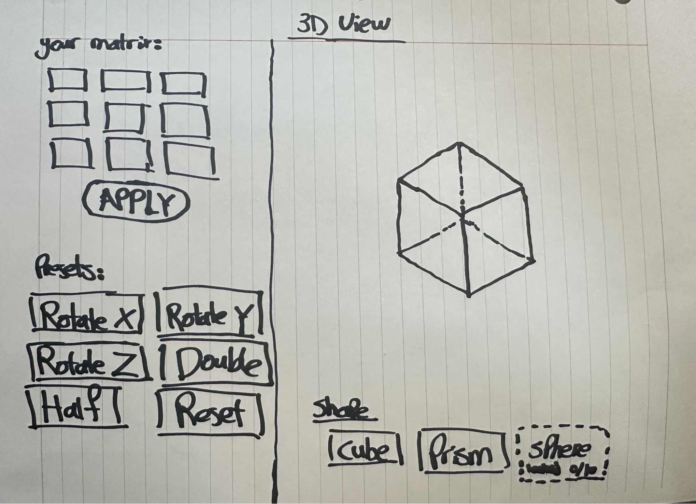

# MTV Specification

## Problem

Linear algebra is a required first-year course for engineering students. However, many beginners to linear algebra may struggle to mentally visualize 3D transformations. This is a challenge, as understanding linear transformations is crucial for excelling in MATH 152 and for their future studies.

However, some students suffer from a condition known as Aphantasia. It is the inability to functionally generate mental imagery and “affects approximately 2–5% of the population” ([source](https://www.frontiersin.org/journals/psychology/articles/10.3389/fpsyg.2025.1615860)).

This inability to visualize makes is nearly-impossible to go from a transformation encoded in a matrix to visualize points moving in their head through 3d space.

As a result, they may rely on memorizing these transformations instead of understanding what they actually do from theory. This leads to the “I didn’t understand how ‘cause I couldn’t see it.” ([source](https://www.frontiersin.org/journals/psychology/articles/10.3389/fpsyg.2025.1615860)).

Currently, students may use sketches from their professor’s lectures or use YouTube videos to visualize a matrix. However, this is restricted to only certain linear transformations. However, when the student is completing their WeBWork homework at home, they are no longer able to utilize such tools for the specific problem. This problem could be mitigated with a tool like MTV.

## Solution

Our solution is a desktop application with only one screen, attached as an image below. The screen is divided into a left and right panel. On the right panel, there will be a rendered 3D shape, either a cube or pyramid, with buttons to select a shape. Upon the student pressing the apply button, the rendered shape will be redrawn with the inputted transformation applied.

On the left panel, there will be a 3x3 grid for the student to input a transformation matrix and a button to apply the inputted transformation. Below will be 6 preset transformations. 3 for rotating around x, y, z axes. One for double scale, another for half scale, and lastly one for resetting the object on the right panel, bringing the selected shape back to its original orientation and scale.

Clicking the apply button multiple times will apply the same transformation multiple times, good for effectively visualizing rotations and reflections. The software interface will take input from both mouse and keyboard, and the UI will scale to fit the screen.

For example, a student might start by selecting the cube option, which begins to draw a cube on the right panel. Then, the student enters the matrix [[2, 0, 0], [0, 2, 0], [0, 0, 2]] into the input fields on the left. Upon clicking the apply button, the displayed cube will be redrawn with the matrix applied, in this case scaled by a factor of 2. If the student wishes, they can press the apply button once more, which will cause the cube to again double in size. From here, the student enters a new matrix, [[0, 1, 0], [-1, 0, 0], [0, 0, 1]], and again presses apply. The cube, which is still scaled, will now also be rotated. If at this point, the student presses the pyramid button, the transformed cube will be replaced with a pyramid with the same transformations applied. Finally, the student presses the reset button, which undoes the applied transformations.

  

